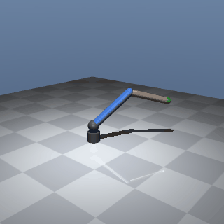
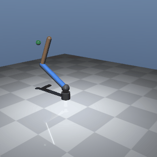
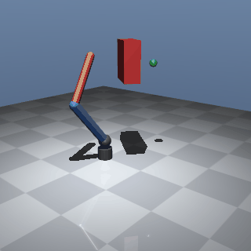
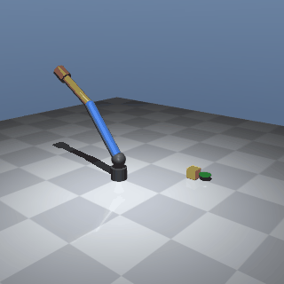

# rl-arm

A 3-joint robot arm in MuJoCo that learns to reach, hold, track, avoid an obstacle and push a cube
with reinforcement learning (Stable-Baselines3). Simulation only, CPU only.

## Overview

- **Robot:** a spatial RRR arm of our own (base yaw, shoulder pitch, elbow pitch), MJCF in `models/arm/`.
  The target is a green mocap ball you can move in code or with the mouse.
- **What the policy sees:** joint angles (sin/cos), joint speeds, tip position and the target.
  **What it outputs:** a small change of each joint's position setpoint (`delta_pos`).
- **Learning:** SAC, mostly with Hindsight Experience Replay. Rewards are dense precision and success
  terms plus small task terms (settle, joint limits, smoothness, collisions); every term is logged.
- **Tasks:** reach → hold (stay within 2 cm) → track a moving target → avoid a box → push a cube.
- Every switch (task, action mode, reward weights, physics, algorithm) lives in a YAML file in `configs/`.
- Design decisions: [docs/SPEC.md](docs/SPEC.md) · plan and checks: [docs/ROADMAP.md](docs/ROADMAP.md) ·
  decision log: [docs/decisions.md](docs/decisions.md) · per-phase reports: [docs/reports/](docs/reports/).

## Demo

Drag the target and the trained hold policy follows it:



```fish
uv run python scripts/demo.py                       # window: double-click the ball, then Ctrl+right-drag
uv run python scripts/demo.py --headless --steps 2000   # scripted target, prints the mean tip-target distance
```

The headless script moves the target smoothly between random reachable points with 2 s pauses; the
policy stays about 15 mm behind it on average. Settings: `configs/demo.yaml`.

| Track | Obstacle | Push |
|---|---|---|
|  |  |  |

## Results

Full tables, seeds and configs: [docs/results.md](docs/results.md) (generated from each run's
`eval.json` by `scripts/make_results.py`). Eval = 100 fixed episodes, 3 seeds, mean ± std.

| Task | Success | Notes |
|---|---|---|
| Reach | 96.0 ± 0.0 % | tip within 2 cm at the end; an analytic IK controller gets 100 % |
| Hold | 95.3 ± 2.5 % | within 2 cm for the last 50 of 250 steps |
| Track | 100 % | 3.7 mm mean error on a moving circle |
| Push | 92.7 ± 2.3 % | cube pushed to within the goal radius |
| Obstacle | 88.7 ± 3.1 % | 1.7 % collisions; uses a path planner + learned residual + safety filter that read the box pose from the simulator (pure RL tops out at ~72 %, see the Phase 5 report) |

Phase 4 experiments (in results.md): position-delta actions beat absolute and torque actions; SAC beats
PPO at equal budget; HER makes a sparse reward work.

## How to run

Needs [uv](https://docs.astral.sh/uv/) and Python 3.12. PyTorch is the CPU build.

```fish
uv sync                                                    # install
uv run pytest -q -m "not slow"                             # fast tests (all: uv run pytest -q)
uv run python scripts/train.py --config configs/hold_final.yaml --seed 0   # writes runs/<run_id>/
uv run python scripts/eval.py --run runs/<run_id>          # eval.json + video
uv run python scripts/watch.py --run runs/<run_id>         # live window of a (training) run
uv run python scripts/check_phase.py 6                     # a phase gate: PASS/FAIL per check
uv run python scripts/make_results.py                      # regenerate docs/results.md
```

Headless rendering uses `MUJOCO_GL=egl`. Trained runs live in `runs/` (not in git), so a fresh clone
has to train before `demo.py`, `eval.py` or the phase checks that read runs can work.

## Project structure

```
configs/          one YAML per experiment (task, actions, reward, physics, algorithm)
models/arm/       MJCF of the arm
src/rlarm/
  envs/           base goal env + one subclass per task (reach, hold, track, obstacle, push)
  kinematics.py   forward/inverse kinematics
  rewards.py      reward terms
  wrappers.py     curriculum, randomisation
  expert.py, sacbc.py, policies.py   obstacle planner, SAC+BC, network parts
scripts/          train, eval, demo, watch, check_phase, make_results, dashboard, ...
tests/            pytest (slow ones marked)
docs/             SPEC, ROADMAP, decisions, results, reports/, media/
runs/             training output (git-ignored)
```
