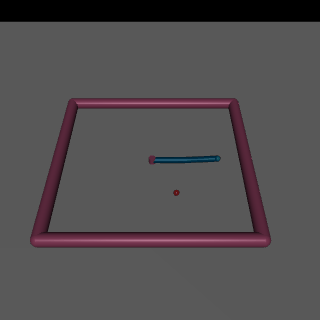
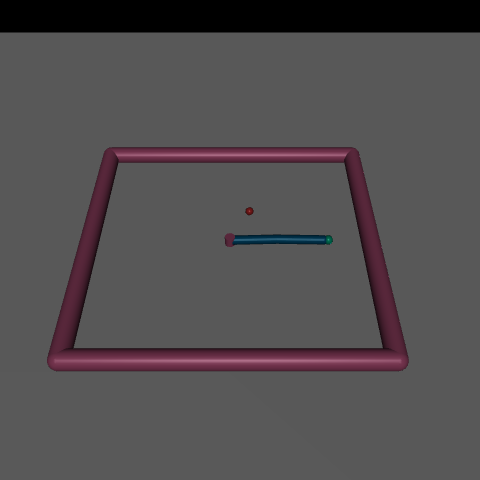

# Phase 0: Setup and warm-up

**Status:** PASS · **Date:** 2026-10-17 · **Commit:** see `git log` (tag `phase-0-done`)

## What was built
uv project (Py 3.12, CPU-only torch), `src/rlarm/` skeleton, config-driven `train.py` / `eval.py` / `render_snapshot.py`, the `check_phase.py` gate, and a SAC-on-Reacher-v5 config proving the pipeline end to end.

## Checks
| ID | Check | Target | Measured | Result |
|---|---|---|---|---|
| 0.1 | imports + versions | succeed | mujoco 3.16.0, gymnasium 1.4.0, sb3 2.9.0, torch 2.14.1+cpu | PASS |
| 0.2 | torch threads from config | ≠16 | 2 (config 2) | PASS |
| 0.3 | headless render | pixel std > 5 | 24.4 | PASS |
| 0.4 | `--dry-run` | < 120 s | 9 s | PASS |
| 0.5 | SAC Reacher return | ≥ −7, ≤300k steps | −3.48 ± 1.35 (100 eps, 300k) | PASS |
| 0.6 | run-folder artifacts | all present | none missing | PASS |
| 0.7 | pytest + ruff | pass | 2 passed; ruff clean | PASS |

## Key numbers
Run `2026-10-17_reacher_sac_s0`, seed 0, 300k steps, 32 min wall (155 steps/s, 2 threads). Random policy ≈ −43.

## Look at this
-  Trained SAC reaching the target (3 episodes): does it go straight to the dot?
-  Headless EGL render works.

## How it works (say this in an interview)
The agent sees Reacher's joint angles/velocities and fingertip-to-target vector, and outputs two joint torques. Reward is negative distance to target minus a small control cost. SAC (off-policy, entropy-regularised) learns from a replay buffer. Everything is chosen by YAML, so a new experiment is a new config.

## Decisions made
See docs/decisions.md lines dated 2026-10-17, phase 0.

## Known issues / next
- `eval.json` is only `{episodes, return_mean, return_std}`; the fixed SPEC §8 schema (success, distance) arrives with the real arm in Phase 1.
- Only one seed was run; 0.5 passes with large margin (−3.5 vs −7).
