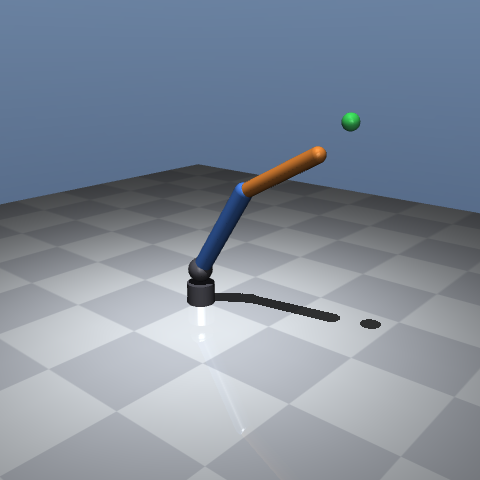

# Phase 1: Arm model and kinematics

**Status:** PASS · **Date:** 2026-10-17 · **Commit:** see `git tag phase-1-done`

## What was built
- `models/arm/arm.xml`: RRR arm (yaw, shoulder pitch, elbow pitch), `tip` site, mocap `target`, floor, camera `main`, position + motor actuator sets.
- `src/rlarm/kinematics.py` (DH forward kinematics, closed-form IK returning all 4 solutions or none) and `src/rlarm/arm.py` (loader: actuator variant, gains, damping from `configs/arm.yaml`).
- `scripts/view.py` interactive viewer; `render_snapshot.py` now renders the raw arm.

## Checks
| ID | Check | Target | Measured | Result |
|---|---|---|---|---|
| 1.1 | 3 hinges, `tip` site, mocap `target` | exact | 3 / yes / yes | PASS |
| 1.2 | FK vs MuJoCo, 1000 configs | < 1e-6 m | 2.2e-16 m | PASS |
| 1.3 | IK round trip, 1000 targets | < 1e-6 m, sample recovered | 4.7e-16 m, 1000/1000, 4 solutions each | PASS |
| 1.4 | Contacts, 2000 random configs (+8 box corners) | 0 | 0 | PASS |
| 1.5 | Position hold under gravity, 5 poses, 2 s | < 2° | 0.50° | PASS |
| 1.6 | Non-blank arm PNG in docs/media | std > 5 | 41.9 (also matches a fresh render) | PASS |

## Key numbers
Limits: yaw ±3.1, shoulder [0.4, 1.7], elbow [-1.1, 1.4] rad. Gains kp=400, kv=20, 12 N·m. No training this phase.

## Look at this
-  Arm at home pose with the target. Judge proportions and the camera framing. Then run `uv run python scripts/view.py` and drag the green target (double-click it, then Ctrl+right-drag) to judge the feel.

## How it works (say this in an interview)
The arm is a 3-joint chain: spin around the base, then two hinges that lift the upper arm and bend the forearm. Forward kinematics multiplies one DH matrix per joint to get the tip position. The inverse solves the elbow triangle with the law of cosines, which gives elbow up and elbow down. Spinning the base by 180° and flipping the shoulder gives two more, so up to four solutions, and none if the target is out of reach. Joint limits keep every allowed pose clear of the floor and of the arm itself, so the later RL env needs no collision handling.

## Decisions made
Seven lines dated 2026-10-17, phase 1, in docs/decisions.md.

## Known issues / next
- Limits are a conservative box: shoulder ≥ 0.4 rad, so the arm cannot reach low in front of the base. The elbow-down branch is only in limits for part of the workspace.
- Masses and link lengths are not yet config-driven (Phase 7). Link lengths are duplicated in `kinematics.py` and the MJCF.
- eval.json SPEC §8 schema moves to Phase 2.
- `view.py` was only smoke-tested (the window opened); I did not drive it interactively.
