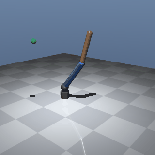
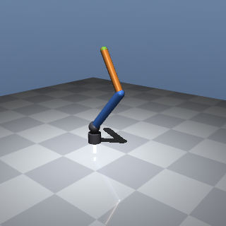

# Phase 2: Environment

**Status:** PASS · **Date:** 2026-10-17 · **Commit:** tag `phase-2-done`

## What was built
Goal-conditioned reach env (`src/rlarm/envs/`), configured by `configs/reach.yaml`. It has 4 action modes, physics parameters from config, and a reward split into logged terms (`rewards.py`, which also logs to TensorBoard as `reward/<term>`). Two baseline agents are in `agents.py`: an IK scripted agent and a random agent. `evaluate_goal` produces the SPEC §8 eval.json schema.

## Checks
| ID | Check | Target | Measured | Result |
|---|---|---|---|---|
| 2.1 | SB3 `check_env`, 4 action modes | passes | all 4 pass, 0 warnings | PASS |
| 2.2 | 5000 random steps per mode: finite, within bounds | no violations | none; max raw \|q̇\| 26.6 rad/s (obs clip at 50) | PASS |
| 2.3 | batched `compute_reward` vs per-step | ≤ 1e-6 | 0.0 over 4×1000 steps | PASS |
| 2.4 | same seed → identical 200-step trajectory | bitwise | identical in all 4 modes (same env reset twice, plus a fresh env) | PASS |
| 2.5 | IK agent, `delta_pos`, 100 eps | ≥ 98 % | 100 %, median final dist 0.0 mm, 34 steps to success | PASS |
| 2.6 | random agent, 100 eps | ≤ 5 % | 0 %, median final dist 407 mm | PASS |
| 2.7 | config mass/damping reaches `MjModel` | changes | upper_arm 1.0→2.0 kg (inertia ×2), damping 0.5→1.5 | PASS |
| 2.8 | each reward term is its own `info` key | all present | r_distance, r_precision, r_success; they sum to the reward | PASS |

## Key numbers
- No training this phase. Control runs at 25 Hz (frame_skip 20 × 2 ms), and episodes last 200 steps (8 s).
- The IK agent reaches the target in ≈34 steps (1.4 s) and then holds it. A random agent ends ≈0.4 m away.
- Gate run time is ≈75 s. There are 14 fast tests in about 4 s.

## Look at this
-  The IK agent on 3 eval seeds. The orange tip should settle on the green target.
-  The last frame: tip on target.

## How it works (say this in an interview)
The agent sees 15 numbers: sin/cos of the 3 joint angles, the scaled joint velocities, the tip position, and the vector from tip to target. The goal is given separately as `achieved_goal`/`desired_goal`, so HER can relabel it later.
It outputs 3 numbers in [−1, 1]. Config decides what they mean: joint-angle increments, absolute joint angles, torques, or torques plus gravity compensation.
Reward = −distance + a sharp bonus near the target (exp(−(d/3 cm)²)) + 1 while within 2 cm. Each term is logged separately.
Targets are sampled as random joint angles passed through forward kinematics, so every target is reachable. An IK controller that scores 100 % proves this, and a random policy that scores 0 % shows the task is not trivial.

## Decisions made
See the `2026-10-17 | 2 |` lines in [decisions.md](../decisions.md): the reward has 3 terms, success is measured at the last step, the obs velocity is clipped, gravcomp goes through ctrl, the physics keys, the IK agent's feedback law, and the review fixes.

## Known issues / next
- I wrote the checks together with the build, so I never saw them fail first. Their discriminating power comes from the agents instead: random scores 0 % and IK scores 100 %.
- 2.3 is structurally easy: the step reward *is* `compute_reward` on the obs goals. It catches batching bugs only. The formula itself is unit-tested in `tests/test_env.py`.
- Success is measured at the last step, which is stricter for learned policies and easier for the random check. A random agent "ever within 2 cm" was not measured.
- eval.json has two schemas: Phase-0 Reacher keeps `return_*` only, and arm tasks use SPEC §8 (+ return). Link lengths are not config-driven yet (Phase 7).
- `reach.yaml` has no `algo` block yet. Phase 3 adds one per experiment.
