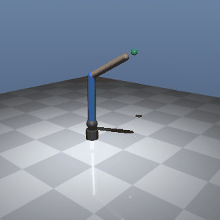
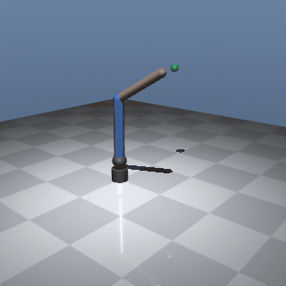

# Phase 3: Learned reach (task A) and hold (task B)

**Status:** PASS · **Date:** 2026-10-18

## What was built
- A `hold` task: success means the tip stays within 2 cm for the final 50 of 250 steps.
- SAC + HER configs for both tasks: `configs/reach_final.yaml` and `configs/hold_final.yaml`.
- A goal-difference feature extractor, plus SPEC §5's settle term (hold only) and joint-limit term.
- Val-best checkpoint selection on validation goals (seeds 50000+, which don't overlap the eval set).
- Checks 3.1–3.5 and `scripts/fresh_eval.py`.

## Checks
| ID | Check | Target | Measured (mean of 3 seeds) | Result |
|---|---|---|---|---|
| 3.1 | Reach success | ≥ 95% | 96.0% (96 / 96 / 96) | PASS |
| 3.2 | Reach median final distance | ≤ 10 mm | 5.7 mm | PASS |
| 3.3 | Hold success | ≥ 90% | 95.3% (93 / 95 / 98) | PASS |
| 3.4 | Hold joint speed, final 50 steps | < 0.05 rad/s | 0.0175 rad/s | PASS |
| 3.5 | GIFs in docs/media | < 3 MB each | reach 1.79 MB, hold 1.36 MB | PASS |

## Key numbers
- **Runs:** `runs/2026-10-18_{reach,hold}_final_s{0,1,2}`. Each run is 1M steps and took about 4.8 h, with 6 runs in parallel. Val-best checkpoints came from 650k–950k steps.
- **How reach success changed** (seed 0):

  | Version | Steps | Eval success | Success on 1000 fresh goals |
  |---|---|---|---|
  | Baseline dense reward | 300k | 43% | – |
  | Tip→target vector ×30 | 300k | 76% | – |
  | HER, no distance term | 1M | 96% | 92.1% |
  | + joint-limit term + val-best | 1M | 96% | **94.7%** |

- **Fresh goals, 1000 per seed:** reach 94.7 / 94.2 / 95.3%, hold 92.5 / 93.1 / 93.8%. The previous 3-seed reach mean was 92.4%.
- **Pilot at 300k steps** (fresh goals): base 86.3%, γ=0.99 83.6%, max_delta 0.1 89.0%, joint-limit term **91.6%**. The joint-limit term won and went into the final configs.

## Look at this
-  Reach, seed 0: does the tip settle on the red target without drifting?
-  Hold, seed 0: does the arm arrive and then stay still?

## How it works (say this in an interview)
The agent sees joint sin/cos, velocities, tip position and goal. Inside the network, the tip→goal difference is scaled ×30 so that millimetre errors are visible. It outputs joint-angle increments of at most 0.05 rad per step.

The reward is a precision bump exp(−(d/3 cm)²), plus +1 inside 2 cm, minus a penalty near joint limits. Hold also gets a speed penalty inside the 2 cm zone.

There is no "−distance" term. Greedy descent on distance pins the arm at a joint limit in 27% of episodes, and that was the old 75% ceiling. HER replays each episode as if its end point had been the goal, so the critic learns the way around the limits.

## Decisions made
See the phase-3 lines dated 2026-10-17 and 2026-10-18 in docs/decisions.md. They cover the hold definition, the 3.4 metric, the dead-end diagnosis, HER, the debug findings, the pilot, and the final configs (option 2, approved by the user).

## Known issues / next
- **Reach has little margin.** It is 96% on the 100-goal eval set but 94.7% on 1000 fresh goals, so the true rate is about 95%.
- **Long joint moves (≥ 2 rad) are the remaining failure mode:** 83–87% success on reach and 81–82% on hold, against about 98% for short moves.
- Reach has no settle term and moves at about 0.1 rad/s at the end. This is not gated, but it matters for Phase 4 smoothness.
- Dry-run ETAs underestimate parallel wall time by about 4×.
- The `configs/reach_sac_*`, `reach_her_lim` and `pilot/*` configs are kept because decisions.md cites their results.
