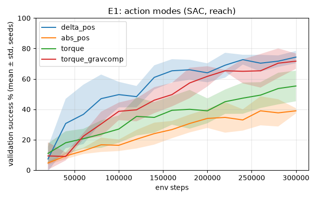
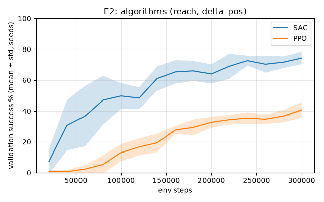
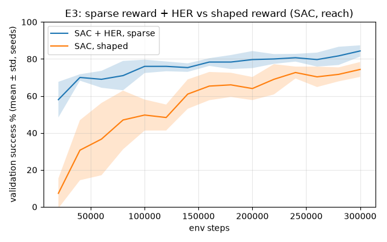

# Results

Generated by `scripts/make_results.py` from each run's eval.json; do not edit by hand.
Eval: 100 episodes on fixed goals (seeds 10000+), deterministic policy, model.zip = best checkpoint on separate validation goals (seeds 50000+). Success = tip within 2 cm at the last step. Smoothness = mean ‖a_t − a_(t−1)‖. Energy (torque modes) = Σ|τ·q̇|·dt per episode. Learning curves: validation success every 20k steps.

## E1: action modes (SAC, reach)

Which action interface learns reach best with the same algorithm, reward and budget?

Seeds: 0, 1, 2  
Step budget: 300,000 env steps per run  
Configs: delta_pos `configs/e1_delta_pos.yaml`, abs_pos `configs/e1_abs_pos.yaml`, torque `configs/e1_torque.yaml`, torque_gravcomp `configs/e1_torque_gravcomp.yaml`

| arm | success % (mean ± std over seeds) | success per seed | median final mm | steps to success | smoothness ‖Δa‖ | energy J |
|---|---|---|---|---|---|---|
| delta_pos | 70.0 ± 11.5 | 71%, 58%, 81% | 13.5 ± 3.4 | 36.3 ± 3.0 | 0.180 ± 0.040 | n/a |
| abs_pos | 31.7 ± 1.5 | 32%, 33%, 30% | 27.7 ± 0.2 | 11.3 ± 0.7 | 0.771 ± 0.044 | n/a |
| torque | 45.7 ± 14.0 | 60%, 45%, 32% | 27.1 ± 17.6 | 9.5 ± 0.2 | 0.429 ± 0.016 | 100.51 ± 7.03 |
| torque_gravcomp | 66.0 ± 9.6 | 59%, 62%, 77% | 12.3 ± 2.2 | 8.5 ± 1.5 | 0.497 ± 0.033 | 119.52 ± 11.28 |

## E2: algorithms (reach, delta_pos)

SAC vs PPO with the same env, reward, network and step budget.

Seeds: 0, 1, 2  
Step budget: 300,000 env steps per run  
Configs: SAC `configs/e1_delta_pos.yaml`, PPO `configs/e2_ppo.yaml`

| arm | success % (mean ± std over seeds) | success per seed | median final mm | steps to success | smoothness ‖Δa‖ | energy J |
|---|---|---|---|---|---|---|
| SAC | 70.0 ± 11.5 | 71%, 58%, 81% | 13.5 ± 3.4 | 36.3 ± 3.0 | 0.180 ± 0.040 | n/a |
| PPO | 49.3 ± 2.3 | 52%, 48%, 48% | 22.1 ± 6.5 | 48.7 ± 5.0 | 0.050 ± 0.017 | n/a |

## E3: sparse reward + HER vs shaped reward (SAC, reach)

Can HER with a pure success reward match SAC with the shaped reward?

Seeds: 0, 1, 2  
Step budget: 300,000 env steps per run  
Configs: SAC + HER, sparse `configs/e3_her_sparse.yaml`, SAC, shaped `configs/e1_delta_pos.yaml`

| arm | success % (mean ± std over seeds) | success per seed | median final mm | steps to success | smoothness ‖Δa‖ | energy J |
|---|---|---|---|---|---|---|
| SAC + HER, sparse | 85.0 ± 5.3 | 79%, 87%, 89% | 8.4 ± 0.6 | 29.3 ± 1.3 | 0.555 ± 0.152 | n/a |
| SAC, shaped | 70.0 ± 11.5 | 71%, 58%, 81% | 13.5 ± 3.4 | 36.3 ± 3.0 | 0.180 ± 0.040 | n/a |

## E4: best RL policy vs classical IK controller (reach, delta_pos)

How close is the learned policy to closed-form IK + a joint-space controller? IK is deterministic and untrained, so it has one run and a 0-step budget.

Seeds: RL (reach_final, SAC + HER): 0, 1, 2; IK controller: 0  
Step budget: RL (reach_final, SAC + HER): 1,000,000; IK controller: 0 env steps per run  
Configs: RL (reach_final, SAC + HER) `configs/reach_final.yaml`, IK controller `configs/e4_ik.yaml`

| arm | success % (mean ± std over seeds) | success per seed | median final mm | steps to success | smoothness ‖Δa‖ | energy J |
|---|---|---|---|---|---|---|
| RL (reach_final, SAC + HER) | 96.0 ± 0.0 | 96%, 96%, 96% | 5.7 ± 0.2 | 32.5 ± 0.7 | 0.476 ± 0.080 | n/a |
| IK controller | 100.0 | 100% | 0.0 | 34.0 | 0.017 | n/a |

## Final task policies (Phases 3 and 5)

The policy kept for each task (docs/best_runs.yaml); the phase reports explain each.

Seeds: 0, 1, 2  
Step budget: reach: 1,000,000; hold: 1,000,000; track: 300,000; push: 1,000,000; obstacle: 400,000, 450,000 env steps per run  
Configs: reach `configs/reach_final.yaml`, hold `configs/hold_final.yaml`, track `configs/track_smooth.yaml`, push `configs/push_smooth.yaml`, obstacle `configs/obstacle_g2.yaml`

| task | success % (mean ± std over seeds) | success per seed | median final mm | task metric |
|---|---|---|---|---|
| reach | 96.0 ± 0.0 | 96%, 96%, 96% | 5.7 ± 0.2 |  |
| hold | 95.3 ± 2.5 | 93%, 95%, 98% | 5.1 ± 0.4 |  |
| track | 100.0 ± 0.0 | 100%, 100%, 100% | 3.5 ± 0.4 | tracking error 3.7 ± 0.2 mm |
| push | 92.7 ± 2.3 | 90%, 94%, 94% | 6.5 ± 2.0 |  |
| obstacle | 88.7 ± 3.1 | 86%, 88%, 92% | 8.1 ± 0.8 | collisions 1.7 ± 2.1 % |
